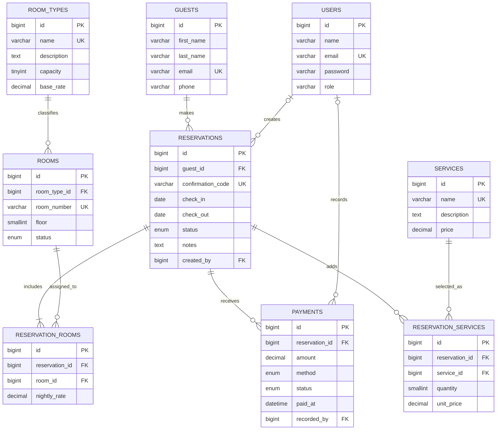

# NHotel Management Database System

## 1. Introduction

### 1.1 Background information

Hotel staff coordinate guest details, room inventory, reservations, check-in/check-out dates and payments. Keeping these records in disconnected spreadsheets makes it harder to locate a guest's stay, identify room conflicts and reconcile payments. A relational database provides one consistent source of truth, enforces references between records and supports operational summaries.

### 1.2 Project description

NHotel is a single-property hotel-management system built with Laravel 12 and MySQL 8. It keeps room categories and inventory, guest contact profiles, staff accounts, reservations, room assignments, optional hotel services and payments. The web interface provides a dashboard, guest and inventory management, multi-room reservations, payment recording and operational reports.

The application validates inputs, authenticates staff, restricts room inventory changes to administrators, prevents overlapping active reservations, records agreed room and service prices, supports pending/confirmed/checked-in/checked-out/cancelled statuses, and prevents payments above the outstanding balance. It is an educational single-property system, not a production payment processor; taxes, refunds, and multiple properties are outside its scope.

### 1.3 ER diagram



### 1.4 Entity relationship model

- A **room type** describes a category of rooms, its capacity and its default nightly price.
- A **room** is an individually numbered unit and belongs to one room type.
- A **guest** is a person identified by a unique email address.
- A **staff account (`users`)** represents an employee who signs in as an administrator or receptionist. Its password is stored as a secure hash. Optional creator/recorder foreign keys preserve who entered reservations and payments.
- A **reservation** belongs to one guest and records the dates, confirmation code and stay status. The optional `created_by` employee documents who entered it.
- A **reservation room** is an associative entity connecting a reservation to an assigned room. Its `nightly_rate` stores the agreed rate for that particular reservation rather than relying on a room type's potentially changing default price.
- A **service** is a priced optional hotel offering. **Reservation service** connects an offering to a stay and snapshots its price and quantity.
- A **payment** records one amount, method, status and timestamp against one reservation; `recorded_by` optionally identifies the employee. A reservation may have multiple payments.

### 1.5 Cardinalities and degree of relationships

| Relationship | Cardinality | Degree | Implementation |
|---|---|---|---|
| Room type classifies room | One room type to zero or many rooms; each room has exactly one type | Binary (1:M) | `rooms.room_type_id` foreign key |
| Guest makes reservation | One guest to zero or many reservations; each reservation has exactly one guest | Binary (1:M) | `reservations.guest_id` foreign key |
| Employee creates reservation | One employee to zero or many reservations; a reservation has zero or one creator | Binary (1:M) | Nullable `reservations.created_by` foreign key |
| Reservation includes room | One reservation to one or many rooms; a room may appear on many reservations over time | Binary M:N, resolved into two 1:M relationships | `reservation_rooms` associative table |
| Reservation receives payment | One reservation to zero or many payments; each payment belongs to one reservation | Binary (1:M) | `payments.reservation_id` foreign key |
| Employee records payment | One employee to zero or many payments; a payment has zero or one recorder | Binary (1:M) | Nullable `payments.recorded_by` foreign key |
| Reservation adds service | One reservation to zero or many services; a service may be used by many reservations | Binary M:N, resolved into two 1:M relationships | `reservation_services` associative table |

Each relationship is binary (degree two); the M:N reservation/room and reservation/service relationships are decomposed through associative entities.

## 2. Relational model

Notation: **PK** = primary key, **FK** = foreign key, **UK** = unique key. All IDs are unsigned auto-incrementing `BIGINT`s. Tables also have nullable `created_at` and `updated_at` timestamps.

### 2.1 Entity tables

| Table | MySQL columns, keys, and rules |
|---|---|
| `room_types` | `id BIGINT UNSIGNED` PK; `name VARCHAR(80)` UK; `description TEXT NULL`; `capacity TINYINT UNSIGNED`; `base_rate DECIMAL(10,2) > 0` |
| `rooms` | `id` PK; `room_type_id BIGINT UNSIGNED` FK → `room_types.id` (delete restricted); `room_number VARCHAR(12)` UK; `floor SMALLINT UNSIGNED DEFAULT 1`; `status ENUM('available','maintenance')`; index (`room_type_id`,`status`) |
| `guests` | `id` PK; `first_name VARCHAR(80)`; `last_name VARCHAR(80)`; `email VARCHAR(190)` UK; `phone VARCHAR(30) NULL`; index (`last_name`,`first_name`) |
| `reservations` | `id` PK; `guest_id` FK → `guests.id` (delete restricted); nullable `created_by` FK → `users.id` (set null on staff deletion); `confirmation_code VARCHAR(16)` UK; `check_in DATE`; `check_out DATE > check_in`; `status ENUM('pending','confirmed','checked_in','checked_out','cancelled')`; `notes TEXT NULL`; index (`status`,`check_in`,`check_out`) |
| `payments` | `id` PK; `reservation_id` FK → `reservations.id` (delete restricted); nullable `recorded_by` FK → `users.id` (set null); `amount DECIMAL(10,2) > 0`; `method ENUM('cash','card','bank_transfer')`; `status ENUM('paid','refunded')`; `paid_at DATETIME`; index (`reservation_id`,`paid_at`) |
| `services` | `id` PK; `name VARCHAR(100)` UK; `description TEXT NULL`; `price DECIMAL(10,2) >= 0` |
| `users` (staff) | Framework authentication columns: `id` PK; `name VARCHAR(255)`; `email VARCHAR(255)` UK; `password VARCHAR(255)` hash; `role VARCHAR(20)` restricted to `administrator` or `receptionist`; remember token and verification timestamp |

### 2.2 Relationship tables

| Table | MySQL columns, keys, and rules |
|---|---|
| `reservation_rooms` | `id` PK; `reservation_id` FK → `reservations.id` (cascade); `room_id` FK → `rooms.id` (delete restricted); `nightly_rate DECIMAL(10,2) > 0`; unique (`reservation_id`,`room_id`); index on `room_id` |
| `reservation_services` | `id` PK; `reservation_id` FK → `reservations.id` (cascade); `service_id` FK → `services.id` (delete restricted); `quantity SMALLINT UNSIGNED > 0`; `unit_price DECIMAL(10,2) >= 0`; unique (`reservation_id`,`service_id`) |

The six core business tables are `room_types`, `rooms`, `guests`, `reservations`, `reservation_rooms`, and `payments`. `services` and `reservation_services` support optional hotel services; `users` plus Laravel's password-reset, session, cache, and job tables support staff authentication and framework operation. Both database setup methods create the same hotel tables and relationships.

## 3. Normalization

The final hotel schema is designed to satisfy Third Normal Form (3NF). Consider this unnormalized draft booking row:

| Confirmation | Guest name/email | Room numbers/types | Stay dates | Payment amounts |
|---|---|---|---|---|
| `DEMO1001` | `Mekdes Abebe / mekdes.abebe@example.test` | `101, 201 / Single, Double` | `2026-11-02` to `2026-11-04` | `4500, 6500` |

It stores repeating values in single fields, repeats guest/room facts across bookings, and makes edits and totals error-prone.

### First Normal Form (1NF)

**Rule:** each field contains one value and each row represents one fact. Replace comma-separated room and payment lists with individual rows. `reservations` stores one guest and one date range; each assigned room becomes a row in `reservation_rooms`; each payment becomes a row in `payments`.

### Second Normal Form (2NF)

**Rule:** be in 1NF and every non-key attribute depends on the whole candidate key, not part of a composite key. In a draft relation with key (`reservation_id`,`room_id`), `confirmation_code` depends only on `reservation_id`, and `room_number` depends only on `room_id`; those are partial dependencies. Move them into `reservations` and `rooms`. The final `reservation_rooms` association stores only its key pair and the agreed `nightly_rate`, which depends on the whole reservation/room assignment. A unique constraint on (`reservation_id`,`room_id`) prevents duplicate assignments.

### Third Normal Form (3NF)

**Rule:** be in 2NF and have no transitive dependencies between non-key attributes. The main functional dependencies include:

- `room_type_id -> name, description, capacity, base_rate`
- `room_id -> room_type_id, room_number, floor, status`
- `guest_id -> first_name, last_name, email, phone` (and `email` is also unique)
- `reservation_id -> guest_id, confirmation_code, check_in, check_out, status, notes`
- (`reservation_id`, `room_id`) `-> nightly_rate`
- `payment_id -> reservation_id, amount, method, status, paid_at`
- `service_id -> name, description, price`
- (`reservation_id`, `service_id`) `-> quantity, unit_price`

For example, room type name and base rate depend on `room_type_id`, not directly on each `room_id`, so those facts live in `room_types` rather than being repeated in `rooms`. Guest contact details, service catalog facts, and payment facts likewise live with their own keys. The saved room and service prices are historical transaction snapshots: they record the rate agreed for one booking and remain correct if a catalog price later changes. This is not a transitive dependency on current catalog data.

## 4. Creating and inserting into tables using MySQL

The standalone script [../database/mysql/hotel_management.sql](../database/mysql/hotel_management.sql) targets MySQL 8.0.16 or newer and is intended for a fresh `hotel_management` database. It creates tables only when absent, does not drop or truncate anything, and skips existing example rows by their demo keys. It does not reconcile a pre-existing, differently structured schema; do not use it as a migration. Run it in MySQL Workbench or:

```powershell
cmd /c "mysql -u root -p < database\mysql\hotel_management.sql"
```

It creates the hotel tables, primary/foreign/unique/index/check constraints, optional services, and fictional Ethiopian demonstration rows. Re-running the sample insert section does not duplicate those examples. The standalone script does not create a staff login or store a sample password. Example presentation queries:

```sql
USE hotel_management;

SELECT r.confirmation_code, CONCAT(g.first_name, ' ', g.last_name) AS guest,
       GROUP_CONCAT(rm.room_number ORDER BY rm.room_number) AS rooms,
       r.check_in, r.check_out, r.status
FROM reservations AS r
JOIN guests AS g ON g.id = r.guest_id
JOIN reservation_rooms AS rr ON rr.reservation_id = r.id
JOIN rooms AS rm ON rm.id = rr.room_id
GROUP BY r.id, g.id
ORDER BY r.check_in;

SELECT s.name, rs.quantity, rs.unit_price
FROM reservation_services AS rs
JOIN services AS s ON s.id = rs.service_id
WHERE rs.reservation_id = 3;

SELECT rt.name AS room_type, COUNT(rm.id) AS room_count, rt.base_rate
FROM room_types AS rt
LEFT JOIN rooms AS rm ON rm.room_type_id = rt.id
GROUP BY rt.id
ORDER BY rt.base_rate;
```

## 5. Hotel Management Database System using Laravel

The implementation uses MySQL-configured Laravel migrations, Eloquent models, a repeatable seeder, and Blade views. Staff login uses Laravel session authentication and hashed passwords; `hotel:user` securely creates an administrator or receptionist without a shared default password. In your existing `.env`, set `DB_CONNECTION=mysql`, `DB_HOST=127.0.0.1`, `DB_PORT=3306`, `DB_DATABASE=hotel_management`, `DB_USERNAME=root`, and enter your actual local MySQL password after `DB_PASSWORD=`. Never paste the password into shared documentation or chat.

```powershell
# Set DB_* in your existing .env for your local MySQL database first.
php artisan migrate --seed
php artisan hotel:user
php artisan serve --host 127.0.0.1 --port 8080
```

Visit `http://127.0.0.1:8080`. `php artisan db:show --database=mysql` is a non-destructive connection check after the correct local credentials are set. Migrations create the application tables and add integrity constraints; the latest migration changes the payments-to-reservations delete rule to `RESTRICT` and adds checks, without deleting or rewriting payment rows. Review the pending migration list and back up your intended database; do not run migrations against an existing MySQL database until you have approved that schema change. Choose either this migration/seed workflow or the standalone SQL script for a fresh setup, not both in the same database.

From the application:

1. Sign in. Administrators manage room and room-type CRUD; receptionists can view inventory.
2. Register and update guest profiles from **Guests**.
3. Create a pending or confirmed reservation by selecting the guest, dates, rooms and optional services.
4. Edit unpaid reservations, then confirm pending bookings. Check guests in during their stay and check them out when finished. Cancelled bookings no longer block a room; bookings with payment history cannot be deleted.
5. Record payments up to the outstanding room-and-service total and review the **Reports** page.

The booking transaction validates dates, locks selected rooms, and checks active reservations for overlapping dates before saving assignments and rate snapshots. Reservation updates and status changes are transactional. Feature tests use a separate SQLite in-memory database; they do not migrate or seed MySQL. Before a live MySQL demonstration, configure your local credentials and confirm the database name carefully.
